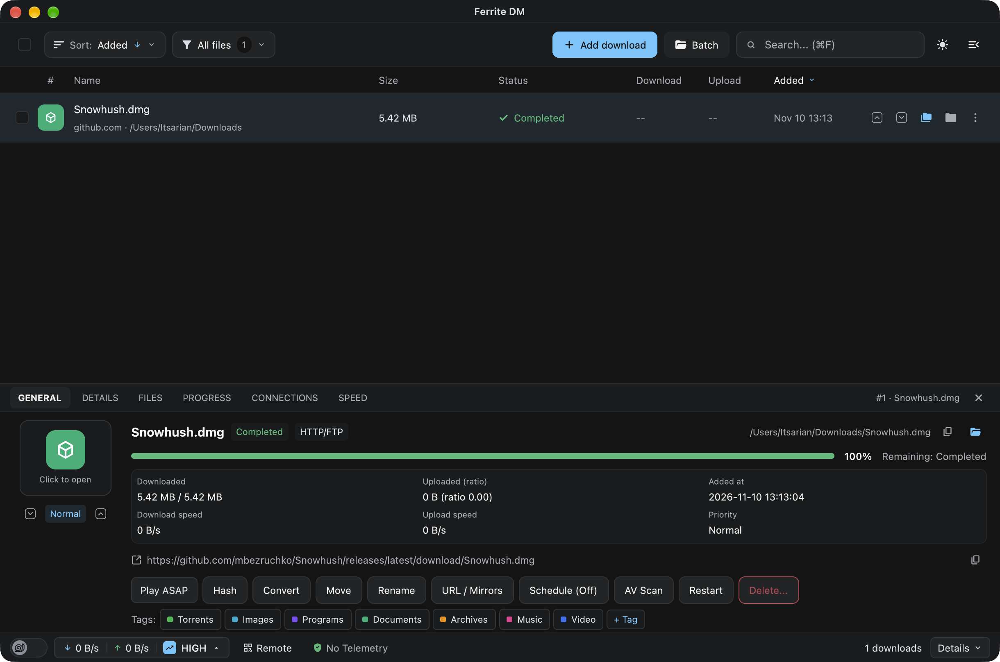

<div align="center">
  

  <h1>Ferrite DM</h1>

  <p><strong>A fast, telemetry-free desktop and CLI download manager built in Rust.</strong></p>

  [](https://github.com/itsarian/ferrite-dm/releases)
  [](https://github.com/itsarian/ferrite-dm/actions)
  [](#license)
  [](#prerequisites)

  <br />

  <a href="#quick-start">Quick Start</a> •
  <a href="#why-ferrite-dm">Why Ferrite</a> •
  <a href="#installation">Installation</a> •
  <a href="#cli-reference">CLI Reference</a> •
  <a href="#desktop-shortcuts">Shortcuts</a> •
  <a href="#configuration">Configuration</a> •
  <a href="#project-structure">Architecture</a>
</div>

<br />

<div align="center">
  
  <p><em>Native GPUI desktop interface with real-time transfer throughput and the 6-tab diagnostic inspector.</em></p>
</div>

---

## Overview

**Ferrite DM** is a modern, local-first alternative to Free Download Manager (FDM 6.x), aria2, and curl. It combines a native GPU-accelerated desktop application with a scriptable CLI tool and background daemon sharing the same transfer engine.

Everything runs locally. Ferrite DM contains zero analytics, no telemetry, no ad banners, and no promotional prompts. All download states, file chunk maps, and mirror metadata are persisted locally in an SQLite database using Write-Ahead Logging (WAL).

---

## Quick Start

### 1. Install or run from terminal

```bash
# macOS installer via script (or download .dmg / .pkg from Releases)
curl -fsSL https://raw.githubusercontent.com/itsarian/ferrite-dm/main/scripts/install-cli.sh | bash
```

### 2. Download via CLI

```bash
# Direct download (runs standalone, or hands off to the GUI/daemon if open)
ferrite-dm https://example.com/archive.tar.gz

# Download with mirror fallback, priority, and wait until complete
ferrite-dm add "https://cdn1.example.com/installer.dmg" \
  --mirror "https://cdn2.example.com/installer.dmg" \
  --priority high \
  --wait
```

### 3. Connect your browser

Integrate one-click download capture with official Chrome, Firefox, Edge, Brave, Opera, or Vivaldi extensions:

```bash
ferrite-dm native-host-install --browser all
```

> [!NOTE]
> When you click a download link in your browser, the native host automatically spawns `ferrite-dm daemon` in the background if neither the GUI nor daemon is already running.

---

## Why Ferrite DM?

| Capability | Ferrite DM | Free Download Manager (FDM 6.x) | aria2 / curl |
| :--- | :--- | :--- | :--- |
| **Privacy & Telemetry** | **Zero telemetry** — 100% local SQLite WAL database | Analytics, telemetry pings, promotional prompts | Clean (CLI only) |
| **Desktop Interface** | **Native GPUI** (sub-millisecond GPU rendering, zero Chromium) | Qt 6 with embedded Chromium views | None (terminal only) |
| **Unified IPC** | Shared Unix socket daemon (`ferrite.sock`) between GUI and CLI | Split internal C++ `VhIpc` layers | Separate process per command |
| **Protocols** | HTTP(S), FTP, BitTorrent (`librqbit`), HLS & DASH streams | HTTP(S), FTP, BitTorrent, YouTube | HTTP(S), FTP, BitTorrent (aria2) |
| **Browser Integration** | Native Messaging host compatible with official FDM extensions | Proprietary extension protocol | Requires third-party bridges |
| **LAN Remote Control** | Built-in self-signed HTTPS + WebSocket with QR-code terminal pairing | Proprietary cloud relay service (`fdmrc`) | External web wrappers |

### Trade-offs & Alternatives

- **Windows Desktop GUI:** File allocation and IPC layers currently leverage POSIX file positioning and Unix domain sockets. Windows support is in development.
- **Single One-off Scripts:** If you only need to fetch a single file in a shell pipeline without queue persistence or chunk resumption, standard `curl` or `wget` is lighter.
- **Dedicated Remote Seedboxes:** For multi-user seedbox servers, dedicated torrent daemons like `transmission-daemon` or `qbittorrent-nox` are more suitable.

---

## Features

- **Multi-Protocol Acceleration:**
  - Multi-connection segmented HTTP/HTTPS and FTP downloads with dynamic chunk splitting and mirror fallbacks.
  - BitTorrent engine powered by `librqbit` supporting magnet links, `.torrent` files, DHT, PEX, LSD, uTP, and sequential "Play ASAP" streaming.
  - HLS (`.m3u8`) and MPEG-DASH (`.mpd`) video stream parsing with AES-128 segment decryption.
- **Native GPUI Interface:**
  - Sub-millisecond GPU rendering via Zed's GPUI framework. Zero Electron or Chromium overhead.
  - 6-tab diagnostic inspector: `GENERAL`, `DETAILS`, `FILES` (interactive file tree), `PROGRESS` (chunk map), `CONNECTIONS` (throughput per peer), and `SPEED` (live transfer graph).
  - macOS integrations: menu bar item, Dock progress badges, sleep prevention (`caffeinate`), and system notifications.
- **Traffic Usage Modes (TUM):**
  - Instant bandwidth throttling profiles: `snail` (64 KiB/s), `low` (512 KiB/s), `medium` (4 MiB/s), and `high` (unlimited).
- **Wildcard Batch Expansion:**
  - Expand URL range patterns like `https://example.com/part-[01-20:2].zip` and brace lists like `{linux,macos}`.
- **Post-Processing & Tools:**
  - FFmpeg integration for MP3 extraction (`ferrite-dm mp3`) and MP4 remuxing (`ferrite-dm mp4`).
  - Cryptographic hash checking (MD5, SHA-1, SHA-256, SHA-512) via `ferrite-dm hash`.
  - Database migration tool (`ferrite-dm import-fdm-db`) to import existing Free Download Manager SQLite history.
- **LAN Remote Control:**
  - Built-in HTTPS and WebSocket server with QR-code terminal pairing for remote queue control from a mobile phone or local computer.

---

## Installation

### macOS (Apple Silicon & Intel)

Download pre-built installers from [GitHub Releases](https://github.com/itsarian/ferrite-dm/releases):

- **Disk Image (`.dmg`):** Open `Ferrite-DM-<version>-macos-<arch>.dmg` and drag **Ferrite DM.app** to `/Applications`.
- **Installer Package (`.pkg`):** Run `Ferrite-DM-<version>-macos-<arch>.pkg` to install the desktop app and configure CLI symlinks (`fdm-gui`, `ferrite-dm`, and `ferrite-native-host`) in `/usr/local/bin`.

Or install via terminal script:
```bash
curl -fsSL https://raw.githubusercontent.com/itsarian/ferrite-dm/main/scripts/install-cli.sh | bash
```

### Linux (CLI & Background Daemon)

Download `ferrite-dm-<version>-linux-x86_64.tar.gz` from [GitHub Releases](https://github.com/itsarian/ferrite-dm/releases):

```bash
tar -xzf ferrite-dm-*-linux-x86_64.tar.gz
cd ferrite-dm-*
./install.sh   # Installs ferrite-dm and ferrite-native-host into ~/.local/bin
```

### Building from Source

Requires Rust Edition 2024 (`rustc >= 1.85`), a C compiler (`clang` or `gcc`), and `cmake`:

```bash
# Clone the repository
git clone https://github.com/itsarian/ferrite-dm.git
cd ferrite-dm

# Build all workspace binaries in release mode
cargo build --release --workspace

# Run the offline loopback self-test suite
./target/release/ferrite-dm self-test
```

Compiled binaries in `target/release/`:
- `fdm-gui` — Native GPUI desktop application.
- `ferrite-dm` — CLI client and background engine daemon.
- `ferrite-native-host` — Browser Native Messaging host.

---

## Prerequisites

- **macOS:** macOS 11+ (Big Sur or newer). Universal support for Apple Silicon (`arm64`) and Intel (`x86_64`).
- **Linux:** x86_64 Linux distribution with glibc 2.31+.
- **Optional Dependencies:** [FFmpeg](https://ffmpeg.org/) (for audio/video conversion) and [yt-dlp](https://github.com/yt-dlp/yt-dlp) (for extended media URL resolution).

---

## CLI Reference

When `fdm-gui` or `ferrite-dm daemon` is running, CLI commands automatically communicate through the Unix domain socket `ferrite.sock`. When run standalone, commands operate directly against the local SQLite database.

```bash
# ---------------------------------------------------------------------------
# Adding Downloads
# ---------------------------------------------------------------------------
# Direct download with mirror fallback and priority
ferrite-dm add "https://cdn1.example.com/installer.dmg" \
  --mirror "https://cdn2.example.com/installer.dmg" \
  --dir ~/Downloads/Installers \
  --priority high \
  --wait

# Expand batch pattern (numeric ranges with step sizes, brace lists)
ferrite-dm batch "https://example.com/parts/part-[01-20:2].zip" --dir ~/Downloads/Parts
ferrite-dm batch "https://example.com/builds/v[1-3]-{linux,macos}.tar.gz" --preview-only

# Inspect torrent metadata or stream sequential video files
ferrite-dm torrent ~/Downloads/sample.torrent --inspect
ferrite-dm torrent "magnet:?xt=urn:btih:..." --select-files 0,2 --play-asap

# ---------------------------------------------------------------------------
# Queue Management
# ---------------------------------------------------------------------------
ferrite-dm list                         # View active downloads table
ferrite-dm list --json                  # Output queue in JSON format
ferrite-dm pause 1                      # Pause download #1
ferrite-dm resume 1                     # Resume download #1
ferrite-dm cancel 1                     # Cancel download #1
ferrite-dm remove 1 --delete-files      # Remove download and delete files from disk
ferrite-dm start-all                    # Start all queued downloads
ferrite-dm pause-all                    # Pause all active downloads

# ---------------------------------------------------------------------------
# Bandwidth Throttling (TUM)
# ---------------------------------------------------------------------------
ferrite-dm tum snail                    # Throttled (64 KiB/s down, 32 KiB/s up)
ferrite-dm tum medium                   # Balanced (4 MiB/s down, 1 MiB/s up)
ferrite-dm tum high                     # Unlimited bandwidth and connections

# ---------------------------------------------------------------------------
# Utilities & Media
# ---------------------------------------------------------------------------
# Verify cryptographic checksum
ferrite-dm hash ~/Downloads/ubuntu.iso --algo sha256 --expect <HEX_DIGEST>

# Extract audio to MP3 via FFmpeg
ferrite-dm mp3 ~/Downloads/podcast.mkv ~/Music/podcast.mp3 --bitrate 320

# Remux or transcode video to MP4 via FFmpeg
ferrite-dm mp4 ~/Downloads/capture.ts ~/Videos/output.mp4 --transcode

# Import existing Free Download Manager SQLite database
ferrite-dm import-fdm-db ~/Library/Application\ Support/Free\ Download\ Manager/db.sqlite

# Run headless background daemon with optional LAN Remote Control
ferrite-dm daemon --remote-control
```

---

## Desktop Shortcuts

Launch the desktop client via `/Applications/Ferrite DM.app` or by running `fdm-gui`.

| Shortcut | Action | Shortcut | Action |
| :--- | :--- | :--- | :--- |
| `⌘N` | Open Add Download modal | `⌘⇧V` / `⌘V` | Paste URL into Add modal |
| `⌘B` | Open Batch Download modal | `Space` | Toggle Pause / Resume on selected item |
| `⌘F` | Focus search and filter bar | `Delete` | Remove selected download |
| `⌘I` | Toggle bottom Inspector pane | `⌘⇧A` | Select all downloads in view |
| `⌘,` | Open Preferences / Settings | `⌘=` / `⌘-` | Zoom in / Zoom out UI |
| `⌘M` | Minimize window | `⌘W` / `⌘Q` | Close window / Quit application |

### Inspector Panel Tabs (`⌘I`)

- **`GENERAL`:** File location, progress bar, total size, ETA, and download speed.
- **`DETAILS`:** HTTP response headers, MIME type, ETag, redirect hops, and mirror fallbacks.
- **`FILES`:** Interactive file tree for multi-file torrent archives and batch packages.
- **`PROGRESS`:** Visual completion map of segmented HTTP chunks and BitTorrent pieces.
- **`CONNECTIONS`:** Active remote IP addresses, connection protocol, and per-peer throughput.
- **`SPEED`:** Real-time download and upload transfer graphs.

---

## Configuration

### Data Paths

State, history, and configuration are stored in your operating system's standard data directory:

- **macOS:** `~/Library/Application Support/org.ferritedm.FerriteDM`
- **Linux:** `~/.local/share/ferritedm` (`$XDG_DATA_HOME/ferritedm`)
- **Portable Mode (`--portable`):** `./ferrite-data` adjacent to the executable binary.

Files stored inside the data folder:
- `db.sqlite` — SQLite database with WAL journaling (downloads, history, chunk maps, tags).
- `config.json` — Persistent settings and bandwidth profiles.
- `ferrite.sock` — Unix domain socket for IPC communication.
- `plugins/` — JavaScript media site parser add-ons.

### Traffic Usage Mode (TUM) Profiles

| Mode | Max Download Speed | Max Upload Speed | Max Conns | Conns / Server | Max Active Downloads | Upload Ratio |
| :--- | :--- | :--- | :--- | :--- | :--- | :--- |
| **`snail`** | 64 KiB/s | 32 KiB/s | 4 | 2 | 1 | 1.0x |
| **`low`** | 512 KiB/s | 128 KiB/s | 12 | 4 | 2 | 1.5x |
| **`medium`** | 4 MiB/s | 1 MiB/s | 32 | 8 | 4 | 2.0x |
| **`high`** | Unlimited | Unlimited | 64 | 16 | 8 | Unlimited |

### Environment Variables

| Variable | Description |
| :--- | :--- |
| `FERRITE_THEME` | Overrides desktop interface theme (`dark`, `light`, or `system`). |
| `FERRITE_UPDATE_MANIFEST_URL` | Custom endpoint for application update manifests. |
| `HOSTNAME` | Hostname used for self-signed TLS certificates when generating LAN Remote Control links. |

---

## Project Structure

Ferrite DM is structured as a modular Cargo workspace across 10 focused crates:

| Crate | What it holds |
| :--- | :--- |
| [`crates/fdm-core`](crates/fdm-core) | SQLite WAL database persistence, data models, token bucket rate limiter, path routing, and OS sleep prevention |
| [`crates/fdm-http`](crates/fdm-http) | Multi-connection segmented HTTP/HTTPS and FTP engine with mirror management |
| [`crates/fdm-bt`](crates/fdm-bt) | BitTorrent engine wrapping `librqbit` with sequential "Play ASAP" streaming |
| [`crates/fdm-hls`](crates/fdm-hls) | HLS (`.m3u8`) and MPEG-DASH (`.mpd`) stream parser with AES-128 segment decryption |
| [`crates/fdm-batch`](crates/fdm-batch) | Wildcard pattern parser expanding numeric ranges and brace expansions |
| [`crates/fdm-media`](crates/fdm-media) | Embedded Boa JavaScript engine for media plugins and FFmpeg conversion helpers |
| [`crates/fdm-ipc`](crates/fdm-ipc) | Unix domain socket protocol (`ferrite.sock`) and LAN Remote Control web server |
| [`crates/fdm-native-host`](crates/fdm-native-host) | WebExtension Native Messaging protocol host executable for web browser capture |
| [`crates/fdm-cli`](crates/fdm-cli) | Command-line interface executable (`ferrite-dm`) and background daemon supervisor |
| [`crates/fdm-gui`](crates/fdm-gui) | Native GPUI desktop application interface (`fdm-gui` / `Ferrite DM.app`) |
| [`docs/ARCHITECTURE_BLUEPRINT.md`](docs/ARCHITECTURE_BLUEPRINT.md) | Reverse engineering analysis, FDM architectural mappings, and protocol specifications |
| [`scripts/`](scripts/) | Packaging scripts (`package-macos.sh`), CLI installers, and icon generation |
| [`resources/`](resources/) | Application icon (`Ferrite-1024.png`, `Ferrite.icns`), screenshots, and `Info.plist` |

---

## Contributing

Contributions from the open-source community are welcome!

1. Fork and clone the repository.
2. Create a feature branch: `git checkout -b feature/my-feature`.
3. Check code formatting and run tests:
   ```bash
   cargo check --workspace
   cargo test --workspace
   ./target/release/ferrite-dm self-test
   ```
4. Commit your changes following conventional commits (`docs:`, `feat:`, `fix:`).
5. Open a Pull Request on GitHub against `main`.

---

## License

Dual-licensed under either:

- **[MIT License](LICENSE-MIT)**
- **[Apache License, Version 2.0](LICENSE-APACHE)**

at your option.
